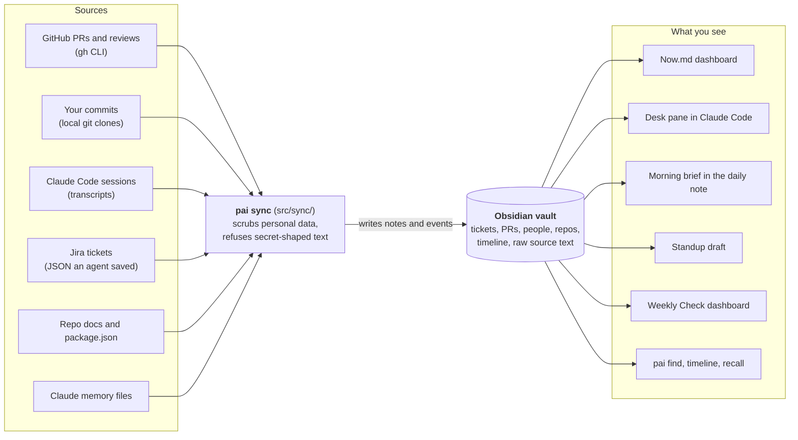
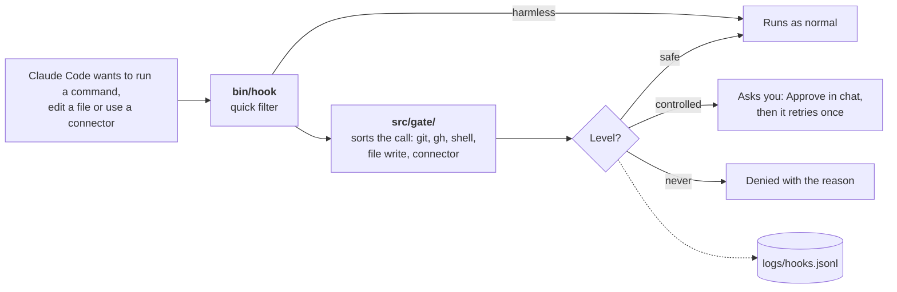
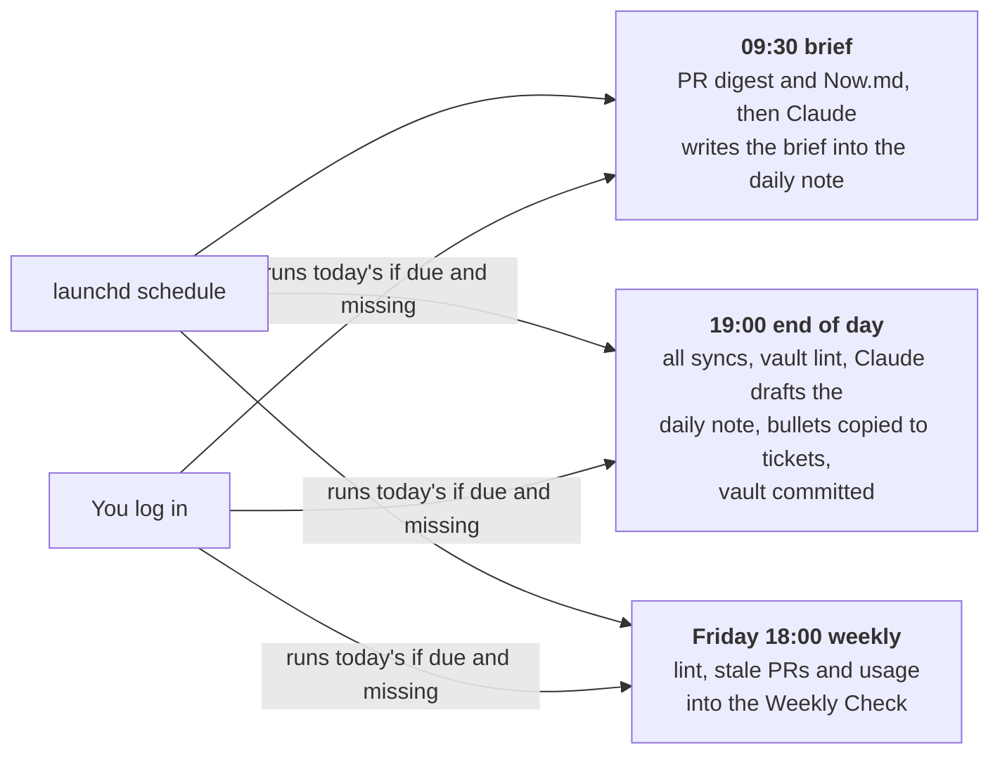

# How personal-ai works

Syncs fill the vault; the gate guards every risky call; routines run both on a schedule.

The diagrams are Mermaid. They render on GitHub, in Obsidian and in VS Code's Markdown preview.

## Data: from your tools into the vault, then back out to you

Now.md, the desk pane and the Weekly Check also read a PR snapshot that `pai prs` saves in the cache folder (open PRs, CI, reviews and next steps).

## Safety: every tool call Claude makes passes the gate

If the gate itself crashes or the config is broken, the call asks instead of passing.

## Routines: run on their own on weekdays

Session start also warns about any run that was missed on an earlier day.

## Dashboards

| Dashboard | Where | What it shows | Updated by |
| --- | --- | --- | --- |
| Now.md | Vault, `01-Dashboard/Now.md` | PRs needing action, open runs, your tickets in flight, review requests, unpushed or uncommitted work, recent commitments. A Pinned section on top is yours and never overwritten | `pai now`, the brief and end-of-day runs |
| Weekly Check | Vault, `01-Dashboard/Weekly Check.md` | Vault lint findings, stale or blocked PRs, seven days of usage | The Friday weekly run |
| Desk pane | Inside Claude Code, `/desk` | PRs by ticket with coloured status, the review queue, a standup draft, a reminder bar before standup; a one-line summary stays in the status line | Reloads every 10 minutes; Refresh pulls PR status from GitHub |
| `pai dash` | Any terminal | The same desk on one screen: what needs you, review requests, open PRs, tickets, runs, loose ends, commitments, routines | Each time you run it; `pai prs` refreshes the PR data |

## What each file does

| File or folder | What it does |
| --- | --- |
| `bin/pai`, `src/cli.ts` | The `pai` command; each subcommand is one entry in a table |
| `bin/hook`, `src/hook.ts` | Claude Code hook: runs the gate, records approvals, caps agents, prints the session-start brief |
| `src/gate/`, `src/shell.ts` | Splits a command into parts, sorts each into a risk category, decides pass, ask or deny |
| `src/sync/` | Pulls GitHub, commits, Jira dumps, sessions, docs, memory, people and repos into the vault |
| `src/vault.ts` | Safe paths inside the vault, atomic writes, frontmatter, generated blocks |
| `src/scrub.ts`, `src/secrets.ts` | Removes personal data; refuses or masks secret-shaped text |
| `src/timeline.ts` | The monthly timeline of events, one line each |
| `src/notes.ts`, `src/promote.ts` | Find and resolve notes; record decisions and feedback; copy daily-note bullets to tickets |
| `src/runs.ts` | Run notes, so multi-step work can resume where it stopped |
| `src/prs.ts`, `src/gh.ts` | Open-PR digest with next steps; the gh CLI wrapper |
| `src/now.ts`, `src/desk.ts` | Builds Now.md, the desk pane data and the standup facts |
| `src/routines.ts`, `src/schedule.ts` | Brief, end of day and weekly; launchd install; missed-run checks |
| `src/loose.ts` | Unpushed commits, uncommitted worktrees, unsent drafts |
| `src/done.ts` | `pai done <ticket>`: removes a finished ticket's worktrees and scratch folder, keeping anything uncommitted or unpushed |
| `src/dash.ts`, `src/style.ts` | `pai dash`: the whole desk on one terminal screen; colour and status marks for terminal output (plain text into pipes and files) |
| `src/release.ts` | Release notes, downmerge check, deploy checklist |
| `src/lint.ts`, `src/text.ts` | Vault conventions; writing rules for anything sent out |
| `src/stats.ts`, `src/transcripts.ts` | Usage and token stats from session transcripts |
| `src/setup.ts`, `src/config.ts` | `pai install` and `pai doctor`; loads and checks `config/assistant.yaml` |
| `src/git.ts`, `src/files.ts` | Shared git runner and safe file writes |
| `mods/desk/` | The desk pane UI inside Claude Code |
| `claude/` | Agents, skills and orchestrator rules that `pai install` links into the workspace |
| `tests/`, `docs/` | Tests on throwaway vaults; scenario checks and the improvement tracker |
